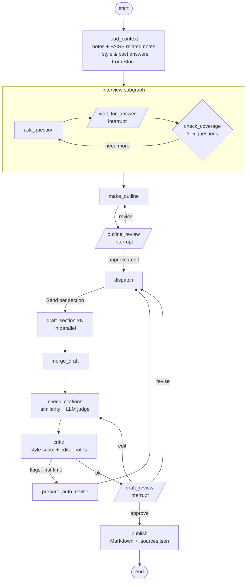
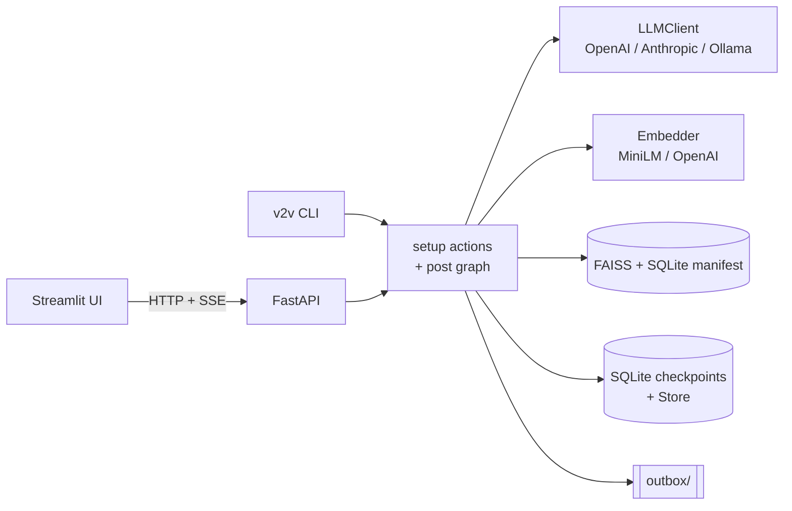

# vault-to-voice


**A LangGraph agent that turns Obsidian notes into blog posts written in your own voice, with every sentence traced back to a source.**

It reads your notes, interviews you for the opinions they don't capture, plans an outline with you, drafts sections in parallel, checks every claim against the notes it cites, critiques its own draft for voice and quality, revises once, and only publishes after you approve.

> The repo ships a fictional `sample_vault/` (every note has `fictional: true`). Your real vault stays on your machine and is never committed.

## Why it's interesting

| Concept | Where it shows up |
|---|---|
| **Agentic workflow (LangGraph)** | One `StateGraph` with a compiled **subgraph** (interview), **conditional routing**, and **`Send` map-reduce** to draft sections in parallel |
| **Human-in-the-loop** | `interrupt()` / `Command(resume=…)` for interview questions, outline review and draft review (approve / revise / edit) |
| **Durable, resumable runs** | SQLite **checkpointer**, one thread per idea; kill the process mid-run and it resumes at the same question. Nodes that pause never call the LLM, so resuming never repeats a paid call |
| **Long-term memory** | LangGraph **Store** holds your style profile and past interview answers across runs |
| **RAG** | FAISS vector index over note chunks; related notes are pulled in by embedding search beyond the idea's own cluster |
| **Grounded generation** | Every sentence carries its sources. A citation checker scores claims by cosine similarity (≥ 0.55 supported, ≤ 0.30 unsupported) and sends the grey zone to a batched **LLM judge** |
| **Self-critique loop** | A critic node measures a **style score** against your writing profile and writes editor notes; flags trigger one automatic revision |
| **Guardrails** | Note text is wrapped as data (prompt-injection defence), instruction-like text is flagged, PII is scrubbed before prompts and checked in output |
| **Evaluation** | `v2v eval` runs fixed cases and reports citation coverage, faithfulness and style score: offline for regression, `--real` for true numbers |
| **Production shape** | FastAPI with **SSE** streaming, Streamlit UI, Typer CLI, opt-in **LangSmith** tracing, pydantic structured outputs, retry policies, CI on GitHub Actions |

## How it works



Ingest is a separate pipeline: **read vault → chunk → embed → FAISS + SQLite manifest → LLM opinion scoring → style profile → idea detection** (per-work ideas, plus theme clusters when the vault is big enough).

### Output

`outbox/2026-10-10-fair-bosses.md` is a clean post with frontmatter and no citation markers. Next to it, `…sources.json` maps every sentence to the note or interview answer it came from, along with the coverage and critic results.

## Architecture



Small modules with protocols at the seams (`VaultReader`, `Embedder`, `LLMClient`, `Publisher`). Every LLM call goes through `LLMClient.structured(prompt, Schema)` and returns a pydantic model. Graph nodes are plain functions with dependencies injected, so each one can be unit-tested without a graph or a real model.

## Quick start

Requirements: Python 3.11+, [uv](https://docs.astral.sh/uv/).

```bash
git clone https://github.com/yogeshmvgd/vault-to-voice.git
cd vault-to-voice
uv sync
cp .env.example .env        # Windows: copy .env.example .env
```

Pick a model in `.env`:

| Option | `.env` | Cost |
|---|---|---|
| **Local (Ollama)** | `LLM_MODEL=ollama:qwen3:8b` and run `uv sync --extra ollama` | Free. Set the Ollama context length to 8192 |
| OpenAI | `LLM_MODEL=openai:gpt-4o-mini`, `OPENAI_API_KEY=…` | A few cents per post |
| Anthropic | `LLM_MODEL=anthropic:<model>`, `ANTHROPIC_API_KEY=…`, `uv sync --extra anthropic` | Pay per use |

Keep `EMBEDDING_PROVIDER=local` for free MiniLM embeddings.

### Use the UI

```bash
uv run v2v serve                                              # terminal 1: API on :8000
uv run streamlit run src/vault_to_voice/ui/streamlit_app.py   # terminal 2: UI on :8501
```

In the sidebar's **Setup** panel, click **Index vault**, then **Build style profile**, then **Find ideas**. Pick an idea, answer the interview, review the outline and draft, and publish.

### Or the CLI

```bash
uv run v2v ingest            # index notes + opinion scores
uv run v2v style             # build your style profile
uv run v2v ideas             # list post ideas
uv run v2v write <idea_id>   # interview → outline → draft → publish (resumable)
uv run v2v eval              # offline eval; add --real to use your model
```

Using your own Obsidian vault? See [docs/obsidian-setup.md](docs/obsidian-setup.md). `VAULT_PATH` must point outside the repo.

## Development

```bash
uv run pytest                     # offline: no API keys, fake LLM + hash embedder
uv run pytest -m integration      # real local MiniLM model
uv run ruff check . && uv run ruff format --check .
```

CI runs lint and the offline test suite on every push. Optional tracing: set `LANGSMITH_TRACING=true` and `LANGSMITH_API_KEY` in `.env`.

Design spec and milestone plans are in [`docs/superpowers/`](docs/superpowers/).

## Tech stack

Python 3.11 · LangGraph · LangChain · FAISS · sentence-transformers · FastAPI · Streamlit · Typer · pydantic · SQLite · LangSmith · uv · ruff · pytest · GitHub Actions

## Roadmap

- [ ] Docker + docker compose
- [ ] Deploy to AWS (free tier) via CI/CD
- [ ] Richer UI
